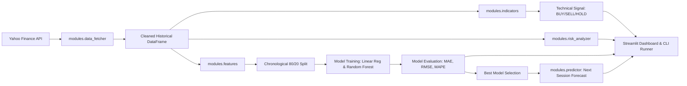
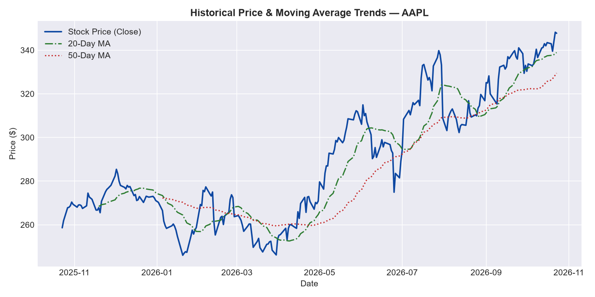
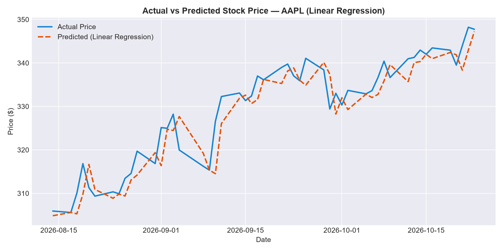
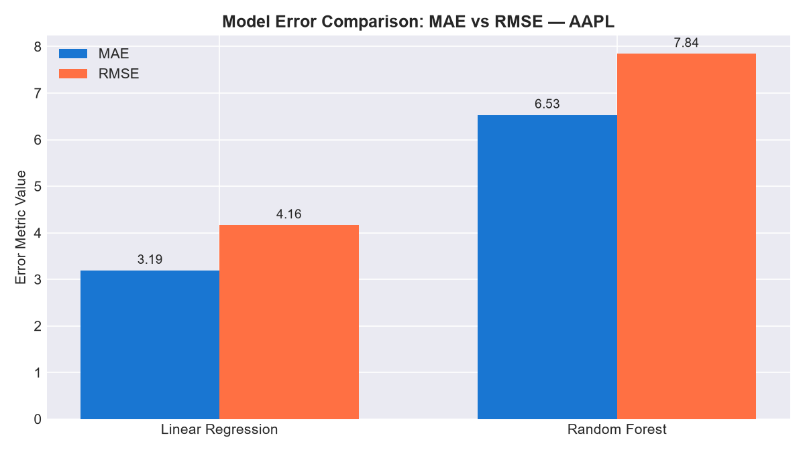

# StockPilot — AI-Powered Stock Prediction Advisor

[](https://www.python.org/)
[](https://streamlit.io/)
[](https://scikit-learn.org/)
[](LICENSE)
[](tests/)

> An interactive market intelligence and machine learning analytics platform for stock price trend forecasting, regression model benchmarking, technical indicator signals, portfolio risk analytics, and multi-currency investment simulation.

---

## Table of Contents
1. [Overview & Problem Statement](#overview--problem-statement)
2. [Key Features](#key-features)
3. [Technology Stack](#technology-stack)
4. [System Architecture](#system-architecture)
5. [Repository Structure](#repository-structure)
6. [Module Responsibilities](#module-responsibilities)
7. [Data Source & Universe](#data-source--universe)
8. [Feature Engineering & Leakage Prevention](#feature-engineering--leakage-prevention)
9. [Machine Learning Methodology](#machine-learning-methodology)
10. [Chronological Train/Test Splitting](#chronological-traintest-splitting)
11. [Evaluation Metrics (MAE, RMSE, MAPE)](#evaluation-metrics-mae-rmse-mape)
12. [Technical Indicators & Signals](#technical-indicators--signals)
13. [Risk Analytics](#risk-analytics)
14. [Installation & Setup (Windows & VS Code)](#installation--setup-windows--vs-code)
15. [Running the Application](#running-the-application)
16. [Automated Testing](#automated-testing)
17. [CLI Analysis & Report Generation](#cli-analysis--report-generation)
18. [User Workflow Guide](#user-workflow-guide)
19. [Visual Dashboard Showcase](#visual-dashboard-showcase)
20. [Limitations & Known Constraints](#limitations--known-constraints)
21. [Financial & Ethical Disclaimer](#financial--ethical-disclaimer)
22. [Future Roadmap](#future-roadmap)
23. [Author & Acknowledgments](#author--acknowledgments)
24. [License](#license)

---

## Overview & Problem Statement

Financial market data is notoriously complex, non-stationary, and noisy. Many introductory machine-learning stock projects suffer from critical technical flaws:
- **Lookahead Bias (Data Leakage):** Using today's closing price in today's features to predict today's price.
- **Random Shuffling:** Using standard `train_test_split(shuffle=True)` on time-series data, effectively training models on future dates to predict the past.
- **Misleading Evaluation Metrics:** Labeling regression errors as "98% accuracy".
- **Unrealistic Guarantees:** Presenting model outputs as guaranteed trading advice.

**StockPilot** was engineered to solve these problems by adhering to rigorous quantitative standards:
1. **Zero Data Leakage:** All predictive features strictly use lagged historical information ($t-1$).
2. **Chronological Arrow-of-Time Splitting:** Past data strictly trains future predictions.
3. **Objective Model Benchmarking:** Side-by-side comparison between an Ordinary Least Squares Linear Regression baseline and a Random Forest ensemble.
4. **Transparent Evaluation:** Reporting dollar-denominated Mean Absolute Error (MAE), Root Mean Squared Error (RMSE), and Mean Absolute Percentage Error (MAPE).
5. **Holistic Analysis:** Combining machine learning forecasts with traditional technical momentum indicators (RSI, MACD, Moving Averages) and portfolio risk metrics (Annualized Volatility, Maximum Drawdown).

---

## Key Features

- **Dark Trading-Terminal User Interface:** Professional Streamlit UI styled with custom dark-navy aesthetics.
- **Dual-Market Coverage:** Supports leading equities across both the **Indian Market (NSE)** and **US Market (NASDAQ/NYSE)**.
- **Automated Data Pipeline:** Defensive handling of Yahoo Finance responses, MultiIndex columns, and missing values.
- **Machine Learning Benchmarking:** Direct side-by-side comparison between Linear Regression and Random Forest Regressor.
- **Next-Session Price Estimate:** One-step-ahead price projections with directional sentiment (`UP 📈`, `DOWN 📉`, `UNCHANGED`).
- **Rule-Based Market Signals:** Multi-indicator momentum engine generating `BUY`, `SELL`, or `HOLD` alerts.
- **Portfolio Risk Analytics:** Computes 252-day annualized volatility, historical maximum drawdown, and mean daily return.
- **Virtual Investment Simulator:** Backtests hypothetical investments across user-defined date ranges with real-time multi-currency foreign exchange conversion.
- **Interactive Visualizations:** Historical moving-average overlays and actual-vs-predicted test timelines.
- **Data Export:** Clean CSV export button for downstream exploratory analysis.
- **Offline CLI Automation:** Standalone runner producing high-resolution Matplotlib graphs and detailed text reports.

---

## Technology Stack

| Domain | Technology / Library | Purpose |
| :--- | :--- | :--- |
| **Language** | Python 3.13.3 | Core programming language |
| **Web Dashboard** | Streamlit (v1.40+) | Reactive dark-terminal user interface |
| **Data Ingestion** | yfinance | Automated historical market data retrieval |
| **Data Processing** | pandas & NumPy | Vectorized time-series manipulations & rolling windows |
| **Machine Learning** | scikit-learn | Linear Regression, Random Forest, & evaluation metrics |
| **Data Visualization** | Matplotlib & Streamlit Charts | Static publication plots and interactive web visualizers |
| **Foreign Exchange API**| requests / open.er-api | Real-time currency conversion rates for investment simulator |
| **Testing Framework** | pytest | Deterministic, offline unit test suite |

---

## System Architecture



For full architectural diagrams and error boundaries, see [docs/PROJECT_ARCHITECTURE.md](docs/PROJECT_ARCHITECTURE.md).

---

## Repository Structure

```text
StockPilot/
│
├── app.py                      # Main Streamlit dashboard application
├── requirements.txt            # Complete production and testing dependencies
├── .gitignore                  # Git ignore rules for virtualenvs, caches, and OS files
├── .python-version             # Python version specification (3.13.3)
├── LICENSE                     # MIT Open-Source License
├── README.md                   # Project documentation and setup guide
│
├── modules/                    # Modular core analytical package
│   ├── __init__.py             # Package exports and public API
│   ├── data_fetcher.py         # yfinance data retrieval, MultiIndex cleaning, validation
│   ├── indicators.py           # Returns, MA20, MA50, RSI(14), MACD, rule-based signals
│   ├── features.py             # Lagged feature engineering (Previous_Close, MA_5)
│   ├── model_trainer.py        # Chronological train/test split, Linear Reg, Random Forest
│   ├── predictor.py            # Next-session forecast construction and directional labeling
│   └── risk_analyzer.py        # Annualized volatility, maximum drawdown, daily returns
│
├── tests/                      # 100% offline pytest test suite (30 tests)
│   ├── __init__.py             # Test package marker
│   ├── conftest.py             # Deterministic synthetic stock data fixtures
│   ├── test_data_fetcher.py    # Unit tests for data ingestion and defensive error boundaries
│   ├── test_indicators.py      # Unit tests for technical indicator math and signal logic
│   ├── test_features.py        # Unit tests verifying zero lookahead bias and feature alignment
│   ├── test_model_trainer.py   # Unit tests for chronological splits and regression metrics
│   ├── test_predictor.py       # Unit tests for next-session prediction alignment
│   └── test_risk_analyzer.py   # Unit tests for volatility, drawdown, and edge-case handling
│
├── scripts/                    # Command-line utility scripts
│   └── run_analysis.py         # Automated CLI pipeline exporting static charts & text reports
│
├── outputs/                    # Exported analytical artifacts
│   ├── graphs/                 # Static charts (actual_vs_predicted, model_comp, trends)
│   └── reports/                # Tabular CSV results and detailed evaluation logs
│
├── assets/                     # UI screenshots and visual assets
│   └── README.md               # Guide to saving dashboard captures
│
└── docs/                       # Comprehensive technical and interview documentation
    ├── PROJECT_ARCHITECTURE.md # Pipeline architecture, data flow, and Mermaid diagrams
    ├── MODEL_METHODOLOGY.md    # Regression mathematics, feature lag, indicators, and risk
    ├── INTERVIEW_PREPARATION.md# 17 technical Q&As tailored for placements and internships
    └── SCREENSHOTS.md          # Step-by-step dashboard visual capture guide
```

---

## Module Responsibilities

- **`modules/data_fetcher.py`**: Interacts with Yahoo Finance; strips whitespace, extracts `Close` prices safely across single and MultiIndex columns, validates minimum length (60 sessions), and raises descriptive `ValueError`s.
- **`modules/indicators.py`**: Computes non-mutating copies of daily percentage returns, 20-day Simple Moving Average, 50-day Simple Moving Average, 14-day Wilder RSI, MACD (12/26 EMA), and 9-EMA signal line. Formulates the rule-based market signal.
- **`modules/features.py`**: Implements lagged predictors `Previous_Close` ($t-1$) and `MA_5` ($t-5$ to $t-1$) with strict zero-leakage alignment.
- **`modules/model_trainer.py`**: Performs chronological 80/20 train/test splitting without shuffling. Fits Linear Regression and Random Forest Regressor, evaluates MAE, RMSE, and MAPE, and selects the model with the lowest test MAE.
- **`modules/predictor.py`**: Builds the feature vector for session $t+1$ and uses the selected trained model to output the estimated next close price and directional label.
- **`modules/risk_analyzer.py`**: Computes sample annualized volatility (252 sessions), maximum peak-to-trough drawdown, and average daily percentage returns.

---

## Data Source & Universe

Stock data is pulled dynamically through Yahoo Finance. The application supports 10 leading equities across two major global markets:

### Indian Market (NSE)
- **Reliance Industries** (`RELIANCE.NS`)
- **Tata Consultancy Services** (`TCS.NS`)
- **Infosys** (`INFY.NS`)
- **HDFC Bank** (`HDFCBANK.NS`)
- **ICICI Bank** (`ICICIBANK.NS`)
- **Tata Motors** (`TMPV.NS`)
- **Larsen & Toubro** (`LT.NS`)
- **State Bank of India** (`SBIN.NS`)
- **Bharti Airtel** (`BHARTIARTL.NS`)
- **ITC** (`ITC.NS`)

### US Market (NASDAQ / NYSE)
- **Apple** (`AAPL`)
- **Microsoft** (`MSFT`)
- **NVIDIA** (`NVDA`)
- **Amazon** (`AMZN`)
- **Alphabet (Google)** (`GOOGL`)
- **Meta Platforms** (`META`)
- **Tesla** (`TSLA`)
- **Broadcom** (`AVGO`)
- **JPMorgan Chase** (`JPM`)
- **Walmart** (`WMT`)

---

## Feature Engineering & Leakage Prevention

In financial forecasting, **lookahead bias (data leakage)** occurs when information from the target period $t$ is leaked into the training features.

StockPilot enforces strict feature lag:
- Target to predict: **$Close_t$**
- Predictor 1: **$Previous\_Close = Close_{t-1}$**
- Predictor 2: **$MA\_5 = \frac{1}{5} \sum_{i=1}^{5} Close_{t-i}$**

Because all predictors are shifted backwards by 1 session, the model predicts the price at day $t$ using only information that was publicly finalized at day $t-1$.

---

## Machine Learning Methodology

StockPilot trains and compares two distinct algorithms:

### 1. Ordinary Least Squares Linear Regression
- Serves as the statistical baseline.
- Fits a linear hyperplane through the lagged feature space:
  $$\hat{y}_t = \beta_0 + \beta_1 \cdot Previous\_Close_t + \beta_2 \cdot MA\_5_t$$
- Fast, interpretable, and immune to complex variance overfitting.

### 2. Random Forest Regressor
- Non-linear ensemble of 100 decision trees (`n_estimators=100`, `max_depth=8`, `min_samples_leaf=3`, `random_state=42`).
- Averages predictions across trees to reduce individual decision-tree variance.
- Constrained depth prevents the forest from memorizing historical market noise.

For full mathematical descriptions, refer to [docs/MODEL_METHODOLOGY.md](docs/MODEL_METHODOLOGY.md).

---

## Chronological Train/Test Splitting

Stock observations are **autocorrelated time series**. Randomly shuffling data violates the temporal order and allows models to memorize future price levels to predict the past.

StockPilot strictly uses **chronological 80/20 partitioning**:
- First 80% of historical sessions: **Training Set**
- Final 20% of historical sessions: **Unseen Test Set**
- $\max(\text{Date}_{\text{train}}) < \min(\text{Date}_{\text{test}})$

---

## Evaluation Metrics (MAE, RMSE, MAPE)

Because stock price estimation is a continuous regression problem, classification accuracy is not applicable:

1. **Mean Absolute Error (MAE):** Average magnitude of forecast errors in original currency units (\$, ₹).
   $$\text{MAE} = \frac{1}{n} \sum_{i=1}^{n} |y_i - \hat{y}_i|$$
2. **Root Mean Squared Error (RMSE):** Penalizes larger forecast misses more severely.
   $$\text{RMSE} = \sqrt{\frac{1}{n} \sum_{i=1}^{n} (y_i - \hat{y}_i)^2}$$
3. **Mean Absolute Percentage Error (MAPE):** Scale-free percentage error measure.
   $$\text{MAPE} = \frac{100\%}{n} \sum_{i=1}^{n} \left| \frac{y_i - \hat{y}_i}{y_i} \right|$$

---

## Technical Indicators & Signals

StockPilot computes four key momentum indicators:
- **20-Day Simple Moving Average (SMA):** Short-term trend baseline.
- **50-Day Simple Moving Average (SMA):** Medium-term trend baseline.
- **Relative Strength Index (RSI 14):** Momentum oscillator bounded between 0 and 100.
- **MACD (12, 26, 9 EMA):** Trend-following momentum indicator.

### Rule-Based Signal Engine
- **BUY:** $Close > MA_{20} \land MA_{20} > MA_{50} \land RSI > 50 \land MACD > MACD\_Signal$
- **SELL:** $Close < MA_{20} \land MA_{20} < MA_{50} \land RSI < 50 \land MACD < MACD\_Signal$
- **HOLD:** When technical momentum conditions are mixed or conflicting.

---

## Risk Analytics

- **Annualized Volatility:** Sample standard deviation of daily returns multiplied by $\sqrt{252}$ trading sessions:
  $$\sigma_{\text{ann}} = \sigma_{\text{daily}} \times \sqrt{252} \times 100\%$$
- **Maximum Drawdown (MDD):** The largest percentage drop from a historical running high:
  $$\text{MDD} = \min_{t} \left( \frac{Close_t - \max_{s \le t} Close_s}{\max_{s \le t} Close_s} \times 100\% \right)$$
- **Average Daily Return:** Arithmetic mean of daily percentage price changes.

---

## Installation & Setup (Windows & VS Code)

### 1. Prerequisites
- **Operating System:** Windows 10 / 11
- **Python:** Python 3.10+ (Developed & tested on Python 3.13.3)
- **Editor:** Visual Studio Code

### 2. Clone Repository & Open Folder
```powershell
# Open Windows PowerShell
cd c:\Users\YOUR_USERNAME\projects
git clone https://github.com/YOUR_USERNAME/stockpilot-stock-prediction-advisor.git
cd stockpilot-stock-prediction-advisor
code .
```

### 3. Create & Activate Virtual Environment
```powershell
# Create virtual environment
python -m venv .venv

# Activate virtual environment
.\.venv\Scripts\Activate.ps1
```

> *Tip: If PowerShell blocks script execution, run `Set-ExecutionPolicy -ExecutionPolicy RemoteSigned -Scope CurrentUser` once.*

### 4. Install Dependencies
```powershell
pip install --upgrade pip
pip install -r requirements.txt
```

---

## Running the Application

Launch the interactive Streamlit dashboard:
```powershell
streamlit run app.py
```
The application will automatically open in your default browser at:
```text
http://localhost:8501
```

---

## Automated Testing

StockPilot includes a comprehensive offline automated test suite using `pytest`. All 30 tests run using deterministic synthetic price paths and require **zero network connectivity**.

To run the complete test suite:
```powershell
pytest -v
```

### Test Coverage Highlights:
- **`test_data_fetcher.py`**: Ticker validation, empty returns, MultiIndex handling, data length thresholds.
- **`test_indicators.py`**: Daily returns, MA20/MA50 math, RSI bounds ($0 \le \text{RSI} \le 100$), BUY/SELL/HOLD signal logic.
- **`test_features.py`**: Zero lookahead bias validation, column alignment, NaN dropping.
- **`test_model_trainer.py`**: Strict chronological split validation, Linear Regression & Random Forest training, MAE/RMSE calculations.
- **`test_predictor.py`**: One-step forecast alignment, feature column ordering, directional sentiment labels.
- **`test_risk_analyzer.py`**: Annualized volatility, mathematical maximum drawdown, zero-variance price tests.

---

## CLI Analysis & Report Generation

For headless environments, server pipelines, or automated reporting, StockPilot includes a standalone command-line script:

```powershell
# Analyze live ticker data (e.g. Apple over 1 year)
python scripts/run_analysis.py --ticker AAPL --period 1y

# Run offline with deterministic synthetic data
python scripts/run_analysis.py --synthetic
```

### Generated Artifacts (`outputs/` directory):
1. **`outputs/reports/model_results.csv`**: Tabular comparison of MAE, RMSE, and MAPE across models.
2. **`outputs/reports/model_evaluation.txt`**: Detailed human-readable evaluation summary.
3. **`outputs/graphs/actual_vs_predicted.png`**: High-resolution test set prediction plot.
4. **`outputs/graphs/model_comparison.png`**: Bar chart comparing Linear Regression vs Random Forest error.
5. **`outputs/graphs/stock_price_trends.png`**: Historical price series plotted with 20-day and 50-day moving averages.

---

## User Workflow Guide

1. **Select Market:** Choose either **Indian Market** (NSE) or **US Market** in the sidebar.
2. **Choose Stock:** Pick any of the 10 supported companies (e.g., Apple, Reliance Industries).
3. **Choose Period:** Select historical lookback (`3mo`, `6mo`, `1y`, `2y`, `5y`, `10y`, `max`).
4. **Click Fetch Data and Analyze:** The application downloads data, computes indicators, prepares features, and trains both models.
5. **Examine Predictions & Comparison:** Inspect the selected best model, test MAE, and next-session price direction.
6. **Review Technical Signals & Risk:** Check the rule-based BUY/SELL/HOLD banner and annualized volatility.
7. **Simulate Investment:** Test hypothetical investments across start and end dates with multi-currency conversion.
8. **Export Data:** Download the prepared analysis DataFrame as a clean CSV for further research.

---

## Visual Dashboard Showcase

| View | Generated Sample / Description |
| :--- | :--- |
| **Price Trends & Moving Averages** |  |
| **Actual vs Predicted (Test Partition)** |  |
| **Model Comparison (MAE vs RMSE)** |  |

*For instructions on capturing and inserting real dashboard screenshots, refer to [docs/SCREENSHOTS.md](docs/SCREENSHOTS.md).*

---

## Limitations & Known Constraints

1. **Market Non-Stationarity:** Financial asset price distributions change over time; models trained on past market regimes may underperform during sudden market crises.
2. **Exogenous Variables:** The current model relies solely on historical price momentum; it does not factor in quarterly earnings reports, macroeconomic interest rate shifts, or breaking news sentiment.
3. **Tree Extrapolation:** Random Forest decision trees predict leaf averages and cannot extrapolate prices higher or lower than the historical training minimum and maximum.
4. **Single-Step Forecasting:** Next-session predictions are designed strictly for one-step-ahead ($t+1$) estimation, not multi-month forecasting.

---

## Financial & Ethical Disclaimer

> [!WARNING]
> **StockPilot is an educational and academic benchmarking platform designed exclusively for software engineering demonstrations, machine-learning research, and campus placement evaluations.**
>
> It does **NOT** provide financial, investment, legal, or tax advice. Stock market trading involves substantial risk of loss. Never execute real-world financial trades based on experimental machine learning models or rule-based indicators.

---

## Future Roadmap

- [ ] Add trading volume and volatility index (VIX) as additional model features.
- [ ] Implement expanding-window (rolling) walk-forward backtesting.
- [ ] Add benchmark comparison against LSTM (Long Short-Term Memory) recurrent neural networks.
- [ ] Introduce portfolio correlation matrix analysis for multi-asset monitoring.

---

## Author & Acknowledgments

- **Author:** [Suhan](https://github.com/YOUR_GITHUB_USERNAME)
- **Degree:** B.Tech in Information Science and Engineering
- **Institution:** [Your College / University Name]
- **LinkedIn:** [Your LinkedIn Profile URL](https://linkedin.com/in/YOUR_LINKEDIN_USERNAME)
- **Portfolio:** [Your Portfolio Website URL](https://yourportfolio.com)

*Developed with guidance from open-source quantitative finance and machine learning communities.*

---

## License

This project is licensed under the **MIT License** — see the [LICENSE](LICENSE) file for details.
