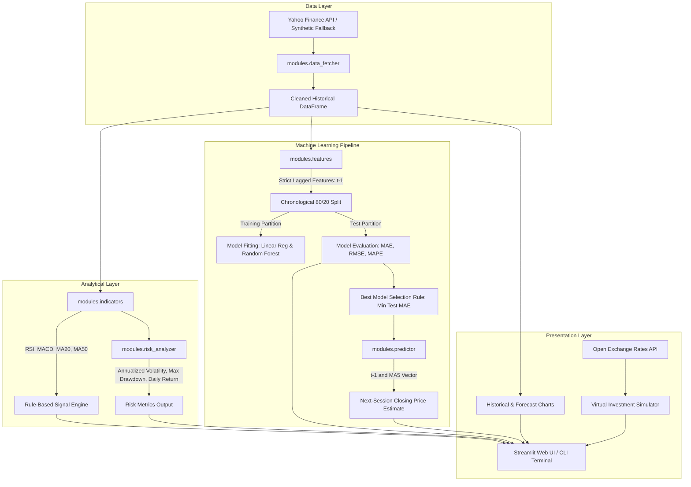

# StockPilot — System Architecture & Data Pipeline

This document details the architectural design, module boundaries, data pipeline, and system flow of **StockPilot (AI-Powered Stock Prediction Advisor)**.

---

## 1. High-Level Architecture Overview

StockPilot follows a modular, decoupled pipeline design where analytical data retrieval, technical indicators, feature engineering, model training, prediction, and risk metrics are isolated into specialized Python modules. The user interface (`app.py`) serves solely as an orchestration layer and interactive presentation dashboard powered by Streamlit.

---

## 2. End-to-End Pipeline Stages

### Stage 1: Data Ingestion & Sanitization (`modules/data_fetcher.py`)
- **Input**: Ticker symbol (e.g. `AAPL`, `RELIANCE.NS`) and historical period (`3mo` to `10y`).
- **Processing**:
  - Fetches data via `yfinance.download(..., auto_adjust=True)`.
  - Normalizes potential Yahoo Finance MultiIndex column formats into a clean single `Close` column.
  - Enforces chronological DatetimeIndex ordering.
  - Validates minimum historical threshold (at least 60 trading sessions).
- **Output**: Clean `pd.DataFrame` with a single validated `Close` price series.

### Stage 2: Technical Indicator Calculation (`modules/indicators.py`)
- **Processing**:
  - `Daily_Return`: Percentage price difference from prior session.
  - `MA_20` & `MA_50`: 20-session and 50-session simple moving averages.
  - `RSI` (14-session): Wilder's Exponential Moving Average ratio between upward price gains and downward price losses.
  - `MACD` & `MACD_Signal`: 12-EMA minus 26-EMA, and the 9-EMA signal line.
  - `generate_technical_signal`: Multi-indicator rule engine evaluating alignment for `BUY`, `SELL`, or `HOLD`.

### Stage 3: Feature Engineering & Leakage Prevention (`modules/features.py`)
- **Core Principle**: Zero lookahead bias.
- **Features**:
  - `Previous_Close`: Price at session $t-1$ (`Close.shift(1)`).
  - `MA_5`: Average price over the prior five sessions ($t-5$ to $t-1$: `Close.shift(1).rolling(5).mean()`).
- **Target**: Closing price at session $t$ (`Close`).
- **Sanitization**: Initial rows containing `NaN` from shifting are removed via `dropna()`.

### Stage 4: Chronological Model Training (`modules/model_trainer.py`)
- **Splitting Strategy**:
  - Chronological 80% train / 20% test split.
  - **No random shuffling**: preserving historical arrow-of-time ensures models are never trained on future observations to predict the past.
- **Algorithms**:
  1. **Ordinary Least Squares Linear Regression**: Baseline linear relationship between lagged momentum and future price.
  2. **Random Forest Regressor**: Non-linear ensemble model with constrained tree depth (`max_depth=8`, `min_samples_leaf=3`, `n_estimators=100`, `random_state=42`) to prevent overfitting.
- **Evaluation**:
  - Calculates Mean Absolute Error (MAE), Root Mean Squared Error (RMSE), and Mean Absolute Percentage Error (MAPE).
  - Model selection is dynamically determined by the lowest test MAE.

### Stage 5: Next-Session Prediction (`modules/predictor.py`)
- Constructs the feature vector for session $t+1$ using the latest known closing price ($Close_{latest}$) and the latest 5-session average ($MA5_{latest}$).
- Generates the single-step ahead price forecast and directional classification (`UP 📈`, `DOWN 📉`, `UNCHANGED`).

### Stage 6: Risk Analytics (`modules/risk_analyzer.py`)
- **Annualized Volatility**: Sample standard deviation of daily returns multiplied by $\sqrt{252}$ trading sessions.
- **Maximum Drawdown**: Minimum percentage dip from any historical running high peak ($\min(Price / \text{cummax}(Price) - 1) \times 100$).
- **Average Daily Return**: Arithmetic mean of percentage daily returns.

---

## 3. Component Interaction & Error Boundaries

- **Network Isolation**: The core machine learning, indicator, feature, and risk logic are entirely independent of live network access. In offline environments or test suites, deterministic synthetic series feed into the exact same pipeline without mock complexity.
- **Defensive Error Handling**:
  - Invalid tickers raise structured `ValueError` exceptions with actionable explanations.
  - Exchange rate failures in the simulator fall back gracefully with clear warnings rather than crashing the dashboard.
- **Separation of Concerns**: Streamlit widgets never perform raw mathematical transformations; they render pre-computed structured dictionaries and DataFrames produced by the backend modules.
